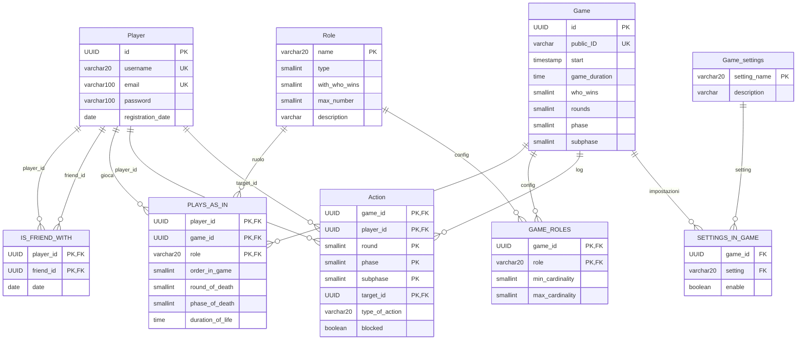
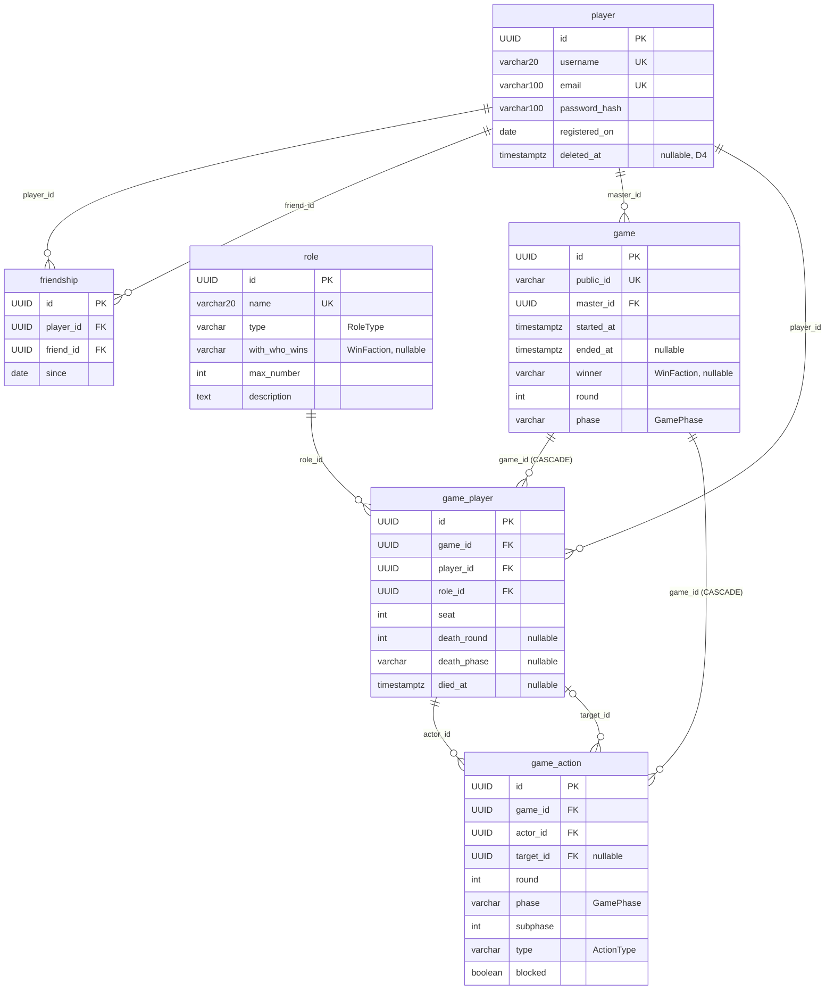

# Report sul database di Lupus in Fabula

Analisi dello schema PostgreSQL del vecchio backend (`src/main/database/`) e di come lo usano i DAO
(`src/main/java/it/unipd/dei/webapp/lupus/dao/`), con una proposta di schema per il nuovo backend
JPA in `backend/`.

Tutti i percorsi sono relativi alla radice del repository. "SQL:NN" vuol dire
`src/main/database/01_database_tables.sql` alla riga NN.

---

## 1. Schema attuale

### 1.1 Tabelle

| Tabella | Chiave primaria | Colonne | Note |
|---|---|---|---|
| `Player` (SQL:21) | `id UUID` | `username VARCHAR(20) UNIQUE`, `email VARCHAR(100) UNIQUE`, `password VARCHAR(100)`, `registration_date DATE` | Tutte NOT NULL. |
| `IS_FRIEND_WITH` (SQL:44) | `(player_id, friend_id)` | `player_id → Player`, `friend_id → Player`, `date DATE` | Amicizia **direzionale**: A→B non implica B→A. |
| `Role` (SQL:64) | `name VARCHAR(20)` | `type SMALLINT`, `with_who_wins SMALLINT`, `max_number SMALLINT`, `description` | Lista fissa di 21 ruoli caricata da `02_populate_db.sql`. Il master è un ruolo (`'master'`, -1, -1). |
| `Game` (SQL:87) | `id UUID` | `public_ID UNIQUE` (es. `dorky-farmer-explorer`), `start TIMESTAMP(0)`, `game_duration TIME`, `who_wins SMALLINT DEFAULT -1`, `rounds SMALLINT DEFAULT 0`, `phase SMALLINT DEFAULT 0`, `subphase SMALLINT DEFAULT 0` | Stato corrente della partita + risultato. |
| `PLAYS_AS_IN` (SQL:117) | `(player_id, game_id, role)` | `player_id → Player`, `game_id → Game`, `role → Role(name)`, `order_in_game`, `round_of_death`, `phase_of_death`, `duration_of_life TIME` | Un giocatore in una partita, incluso il master (con ruolo `'master'`, `order_in_game = 0`). |
| `GAME_ROLES` (SQL:145) | `(game_id, role)` | `min_cardinality`, `max_cardinality` | **Nessun DAO la usa.** |
| `Action` (SQL:167) | `(game_id, player_id, round, phase, subphase, target_id)` | `type_of_action VARCHAR(20)`, `target_id → Player NOT NULL`, `blocked BOOLEAN` | Log di tutto ciò che succede: voti di giorno, azioni notturne. |
| `Game_settings` (SQL:197) | `setting_name` | `description` | 3 righe, tutte "(not yet implemented)" (`02_populate_db.sql`). |
| `SETTINGS_IN_GAME` (SQL:214) | **nessuna** | `game_id → Game`, `setting → Game_settings`, `enable BOOLEAN` | Scritta alla creazione partita (`AddGameSettingDAO`), letta da `GetGameSettingsDAO`. |

### 1.2 Significato reale dei valori numerici (ricavato dal codice)

| Colonna | Valori | Dove si vede |
|---|---|---|
| `Role.type` | -1 master, 0 good, 1 evil, 2 victory stealer, 3 neutral | `utils/RoleType.java` |
| `Role.with_who_wins`, `Game.who_wins` | -1 nessuno (master / partita in corso), 0 farmers, 1 wolves, 2 hamster, 3 jester, 10 pareggio | `utils/WinFaction.java` (`NOT_FINISH(-1)`, `DRAW(10)`) |
| `Game.phase`, `Action.phase`, `PLAYS_AS_IN.phase_of_death` | 0 notte, 1 giorno | `utils/GamePhase.java` |
| `Game.rounds` | 0 e 1 significano entrambi "primo round": il codice fa `game.getRounds() == 0 ? 1 : game.getRounds()` | `rest/GameActionsPostRR.java:139`, `rest/GameStatusUpdateRR.java:121,158` |
| `Game.subphase` | sempre 0: **nessuna query la scrive mai** (`UpdateGameDAO.java:24,29` aggiorna solo `rounds`, `phase`, `who_wins`) | grep su `subphase` |
| `Action.subphase` | di notte 0; di giorno 0 = prima votazione, 1 = primo ballottaggio, 2 = secondo ballottaggio; le azioni extra (sam, plague, carpenter) prendono il valore raggiunto (fino a 3) | `GameActionsPostRR.java:266,276,286` |
| `Action.type_of_action` | testo libero: `'vote'` (`resource/Action.java:28`) o il campo `action` di `GameRoleAction` (`maul`, `investigate`, `protect`, `shot`, `rage`, `point`, `explore`, `block`, `plague`, `look`, `revenge`, `last chance`, `blowup`) | `utils/GameRoleAction.java` |
| `PLAYS_AS_IN.round_of_death` | `NULL` (o 0, vedi problema P5) = vivo; >0 = round della morte | `GetDeadPlayersByGameIdDAO.java:65`, `IsPuppyAWolfDAO.java:24` |
| `PLAYS_AS_IN.order_in_game` | posto al tavolo; il master ha 0 | populate, `GetGamePlayersDAO.java:28` |

### 1.3 Diagramma



---

## 2. Problemi trovati

Ordinati per gravità. Per ognuno: dove, perché è un problema, esempio.

### Gravità alta

**P1. `ResetGameToDAO` cancella/modifica dati di altre partite** (bug di precedenza degli operatori, non in `bug.md`)
- Dove: `dao/ResetGameToDAO.java:23` e `:30`.
  ```sql
  DELETE FROM action WHERE game_id = ? AND (round > ?) OR (round = ? AND phase >= ?)
  ```
- Perché: in SQL `AND` lega più forte di `OR`, quindi la condizione è
  `(game_id = ? AND round > ?) OR (round = ? AND phase >= ?)`: il secondo ramo non filtra per partita.
- Esempio: il master della partita A, al giorno del round 3, preme "round precedente"
  (`GameStatusUpdateRR.previousRound`, riga 169-170): vengono cancellate **tutte le azioni del round 3
  di tutte le partite**, anche quelle finite (i log storici spariscono), e l'UPDATE su `plays_as_in`
  "resuscita" i giocatori morti al round 3 in ogni altra partita.
- Nel nuovo backend: con JPA si scrive `deleteByGameAndRoundGreaterThan...` o una JPQL con le parentesi
  giuste; il punto è che la condizione su `game` deve stare fuori dall'`OR`.

**P2. Il master è un "ruolo" in `PLAYS_AS_IN`, e il DB non garantisce niente su di lui**
- Dove: riga `('master', -1, -1, 1, ...)` in `02_populate_db.sql`; quasi ogni query sui giocatori deve
  escluderlo con `role != 'master'` (`GetDeadPlayersByGameIdDAO`, `GetPlayersByGameDAO`,
  `SelectPlayersAndRolesByGameIdDAO`, `GameConfigurationDAO`, ...) e il master si trova con
  `WHERE role = 'master'` (`GetMasterFromIdGameDAO.java:22`).
- Perché: il master non è un ruolo del gioco (non ha fazione, non muore, non vota), ma è modellato come
  tale. Così: (a) nulla impedisce zero o due master in una partita; (b) ogni nuova query rischia di
  dimenticare il filtro e trattare il master come un giocatore; (c) servono valori finti per lui
  (`type = -1`, `with_who_wins = -1`).
- Esempio: in `extra/03_populate_db_optional.sql` le partite `log_game_*` hanno il master con
  `order_in_game = 1`, `round_of_death = 1` e `duration_of_life = '00:01:00'`: un master "morto al round 1".
  Il DB lo accetta.
- Soluzione naturale: `Game.master` come `@ManyToOne Player` (vedi sezione 3, e domanda D2).

**P3. La chiave primaria di `PLAYS_AS_IN` permette lo stesso giocatore due volte nella stessa partita**
- Dove: SQL:126, `PRIMARY KEY (player_id, game_id, role)`.
- Perché: la chiave include `role`, quindi è unica la tripla, non la coppia (giocatore, partita).
  La regola vera del dominio è "un giocatore ha un solo ruolo per partita".
- Esempio: `INSERT (Nick, partita1, 'wolf')` e `INSERT (Nick, partita1, 'seer')` passano entrambe.
  Il codice se ne accorge a metà: `GetRoleByGameIdAndPlayerUsernameDAO.java:21` fa
  `ORDER BY order_in_game` e prende la prima riga, cioè "sceglie" un ruolo a caso fra quelli duplicati.
- Manca anche `UNIQUE (game_id, order_in_game)`: due giocatori possono avere lo stesso posto
  (succede davvero nei dati `log_game_*`: `log_player` e `log_master` hanno entrambi `order_in_game = 1`).
  Il posto serve alla regola della peste (vicini a destra/sinistra) e all'ordine di voto.

**P4. "Cancellare l'account" non cancella niente e l'account resta utilizzabile**
- Dove: `dao/DeletePlayerDAO.java:20`: `UPDATE player SET email = ? WHERE LOWER(username) = LOWER(?)`,
  con entrambi i parametri = username.
- Perché: non esiste un modo nel modello dati per dire "account eliminato" (né flag né `ON DELETE`),
  quindi la "cancellazione" sovrascrive l'email con lo username. Username e password restano, e
  `LoginPlayerDAO.java:25` cerca per `username OR email`: l'utente "cancellato" può ancora fare login.
  Inoltre non si poteva fare un vero `DELETE`: tutte le FK verso `Player` sono senza `ON DELETE`
  (default `NO ACTION`), quindi il DELETE fallirebbe appena il giocatore ha giocato una partita, e il
  ruolo `lupus_sql` non ha comunque il permesso `DELETE` su `player` (SQL:263).
- Vedi domanda D4 (soft delete con `deletedAt` + anonimizzazione, oppure hard delete).

**P5. `round_of_death`: due convenzioni diverse per "vivo" (NULL e 0)**
- Dove: commento SQL:134 dice "0 se è vivo"; `ResetGameToDAO.java:30` rimette `NULL`; i populate
  usano `null` per i vivi nelle partite in corso ma `0` nelle partite `log_game_*`.
  Le query non sono d'accordo:
  - `GetDeadPlayersByGameIdDAO.java:65`: `rs.getInt("round_of_death") > 0` (JDBC trasforma NULL in 0,
    quindi funziona con entrambe);
  - `GetDeadPlayersInformationByGameIdDAO.java:30`: `round_of_death > 0` (funziona con entrambe);
  - `IsPuppyAWolfDAO.java:24`: `round_of_death IS NULL` (un lupo "vivo con 0" è considerato **morto**).
- Perché: un valore magico (0) al posto di NULL obbliga ogni query a ricordarsi la convenzione.
  Se due convenzioni convivono, il risultato dipende da quale query si usa.
- Esempio: con `round_of_death = 0` per un lupo vivo, il cucciolo (puppy) diventa lupo anche se il
  branco è ancora vivo.
- Inoltre `round_of_death` e `phase_of_death` vanno insieme, ma nessun CHECK lo impone
  (si può avere round senza fase).

### Gravità media

**P6. CHECK sbagliato su `Role.with_who_wins`**
- Dove: SQL:68: `with_who_wins SMALLINT NOT NULL CHECK ( type IN (-1, 0, 1, 2, 3) )`.
- Perché: il CHECK controlla `type` invece di `with_who_wins` (copia-incolla della riga sopra), quindi
  `with_who_wins` non ha alcun vincolo: `with_who_wins = 99` viene accettato. In più `type` e
  `with_who_wins` usano gli stessi numeri con significati diversi (`type = 2` è "victory stealer",
  `with_who_wins = 2` è "hamster"): il jester ha `type = 2, with_who_wins = 3`. Facile confonderli.
- Con enum salvati come STRING (`'VICTORY_STEALER'`, `'JESTER'`) il problema sparisce: il valore si
  legge da solo e Hibernate genera un CHECK con i valori ammessi dell'enum giusto.
  Il nuovo backend lo fa già (`model/Role.java`).

**P7. Valori magici al posto di NULL/enum in `Game`**
- Dove: SQL:93-96.
  - `who_wins DEFAULT -1` = "non finita", `10` = pareggio (`WinFaction.java`). "Non finita" non è una
    fazione vincitrice: è l'assenza di un vincitore, cioè NULL. In Java questo diventa
    `if (game.getWho_win() == -1)` sparsi ovunque (`PossibleGameActions.java`, `GameActionsPostRR.java:143`,
    `PlayerInGameDAO.java:20`, `GetStatsPerRoleDAO.java:34`).
  - `rounds DEFAULT 0` ma 0 vuol dire 1 (vedi 1.2): è un default sbagliato compensato in 3 punti del
    codice. Basta `DEFAULT 1`.
  - `phase` 0/1: un enum `NIGHT/DAY` è più leggibile e non accetta valori fuori dominio.
- Il CHECK `(phase = 0 AND subphase = 0) OR (phase = 1 AND subphase >= 0)` (SQL:97, 178) è ridondante:
  la seconda parte vale sempre dato il CHECK su `subphase`.

**P8. `Game.subphase` è una colonna morta**
- Dove: SQL:96. Viene letta (`GameActionsPostRR.java:141`) ma mai scritta, quindi vale sempre 0.
  Il codice usa la sottofase solo localmente, durante l'elaborazione dei voti di una giornata, e la
  salva nelle righe di `Action`. Si può togliere da `Game` (tenerla solo in `Action`).

**P9. `GAME_ROLES` e impostazioni di partita: tabelle inutili**
- `GAME_ROLES` (SQL:145): nessun DAO la legge o la scrive (grep `game_roles` su `dao/` e `rest/`).
  La configurazione dei ruoli di una partita si ricava contando `PLAYS_AS_IN` per ruolo, ed è
  esattamente quello che fa `GameConfigurationDAO.java:27-31`. Il limite per ruolo sta già in
  `Role.max_number`.
- `Game_settings` / `SETTINGS_IN_GAME`: le 3 impostazioni sono tutte "(not yet implemented)". Le righe
  vengono comunque scritte a ogni creazione partita (`GameCreationPostRR.java:274-275`) e lette per
  la pagina di gioco, dove il frontend le ignora (`bug.md` n. 40). Inoltre `SETTINGS_IN_GAME` **non ha
  chiave primaria**: la stessa impostazione può comparire due volte per la stessa partita, anche con
  valori opposti (`TRUE` e `FALSE`), e `enable` è nullable. Salvare righe con `enable = FALSE` è
  ridondante: l'assenza della riga dice già "disattivata".
  `AddGameSettingDAO.java:21` fa `INSERT INTO settings_in_game VALUES (?,?,?)` senza nomi di colonna,
  quindi dipende dall'ordine delle colonne nella tabella. Vedi domanda D1.

**P10. Durate salvate come `TIME` e calcolate in due modi diversi**
- Dove: `Game.game_duration TIME` (SQL:92), `PLAYS_AS_IN.duration_of_life TIME` (SQL:125);
  `UpdateGameDAO.java:29`: `game_duration = now() at time zone 'Europe/Rome' - start`;
  `UpdateDeathOfPlayerInTheGameDAO.java:21`: `duration_of_life = NOW() - (SELECT game.start ...)`.
- Perché:
  - `TIME` è un'**ora del giorno**, non una durata (il tipo giusto in PostgreSQL è `INTERVAL`).
    La sottrazione di timestamp dà un `interval`, che convertito a `time` perde i giorni.
    In Java arriva come `java.sql.Time` (`rs.getTime`), cioè di nuovo un orario.
  - Sono **colonne derivabili**: con l'istante di fine partita e l'istante di morte salvati, le durate si
    calcolano (`Duration.between(start, end)`). Salvare il dato derivato e non quello originale fa
    perdere informazione: oggi non si sa a che ora è finita una partita, solo quanto è durata.
  - Le due formule sono diverse: una converte esplicitamente in ora di Roma, l'altra usa il fuso della
    sessione. Coincidono solo perché i container hanno `TZ=Europe/Rome` (`docker-compose.yml:10,27`);
    avviando il backend dall'IDE con un altro fuso, `game_duration` sarebbe sbagliata dello scarto.

**P11. `TIMESTAMP` senza time zone per `Game.start`**
- Dove: SQL:91, scritto con `NOW()` (`CreateGameDAO.java:27`).
- Perché: `TIMESTAMP` salva "ora locale da orologio a muro" senza dire di quale fuso. `NOW()` viene
  convertito nel fuso della sessione JDBC (che pgjdbc prende dalla JVM). Problemi:
  - il valore cambia significato se cambia il fuso della JVM o del DB;
  - al cambio dell'ora legale le differenze sono sbagliate. Esempio: partita iniziata alle 02:50
    CEST del 25/10/2026 e finita 20 minuti dopo, alle 02:10 CET: `02:10 - 02:50` dà -40 minuti.
- Usare `TIMESTAMPTZ` (in Java `Instant`): salva un istante assoluto, il fuso serve solo per mostrarlo.
  `Player.registration_date DATE` e `IS_FRIEND_WITH.date DATE` invece vanno bene (sono date di calendario).

**P12. `Action`: chiave primaria troppo larga e insieme troppo stretta, segnaposto al posto di NULL**
- Dove: SQL:167-179.
- Chiave `(game_id, player_id, round, phase, subphase, target_id)`: non contiene `type_of_action`, quindi
  lo stesso giocatore non può fare due azioni diverse sullo stesso bersaglio nella stessa sottofase.
  Scenario possibile: il berserker che usa la rabbia (`rage`) su X ed è anche il lupo scelto per sbranare
  (`maul`) X nella stessa notte: la seconda INSERT viola la chiave. Una chiave a 6 colonne inoltre
  va ripetuta in ogni riferimento e in JPA richiede una `@EmbeddedId` scomoda.
- `target_id NOT NULL`: le scelte "nessun bersaglio" (`"No shot"`, `"No rage"`,
  `PossibleGameActions.java:270,298`) non si possono registrare. Il codice usa segnaposto: il carpenter
  ha come bersaglio se stesso (`GameActionsPostRR.java:562`), e lo sceriffo che sbaglia salva come
  bersaglio se stesso invece del giocatore colpito (`:1036`), quindi il log perde chi aveva sparato.
- `type_of_action VARCHAR(20)` senza CHECK: un refuso (`'mual'`) viene accettato e le query
  `WHERE type_of_action = 'maul'` non lo trovano.
- `player_id` / `target_id` puntano a `Player`, non a "giocatore di questa partita": il DB non
  impedisce un'azione su chi non sta giocando la partita.

**P13. Nessun `ON DELETE` e nessuna transazione**
- Nessuna FK ha `ON DELETE` (default `NO ACTION`). Per cancellare una partita bisogna cancellare a mano
  prima `Action`, `PLAYS_AS_IN`, `GAME_ROLES`, `SETTINGS_IN_GAME`. Per un giocatore vedi P4.
  Per i figli di `Game` (giocatori della partita, azioni) il comportamento giusto è `CASCADE`: non
  hanno senso senza la partita. Per `Player` invece `RESTRICT` (o soft delete), perché una partita
  passata non deve sparire quando un partecipante lascia il sito.
- `GameActionsPostRR.java:371-377` inserisce ogni azione e ogni morte con una connessione nuova in
  autocommit (`access()` chiude la connessione). Se la quinta INSERT fallisce, le prime quattro restano:
  partita in uno stato a metà. In Spring basta `@Transactional` sul metodo del service.

**P14. Permessi del ruolo `lupus_sql`**
- Dove: SQL:238-266.
- Il principio (un utente applicativo con permessi minimi, separato dal proprietario dello schema) è
  giusto, ma:
  - password `'wolf'` scritta in chiaro in un file versionato (SQL:261);
  - il blocco `REVOKE` (SQL:243-249) non serve: le tabelle sono appena state ricreate (DROP a SQL:3-11),
    quindi non hanno permessi da revocare; in più dimentica `game_settings` e `settings_in_game`;
  - nessun `DELETE` su `game`, `player`, `plays_as_in`: coerente con il soft delete di P4, ma rende
    impossibile anche ripulire una partita creata per errore;
  - `GRANT ... ON GAME_ROLES` per una tabella mai usata.
- Nel nuovo backend (`backend/compose.yaml`) l'app si collega con `POSTGRES_USER=lupus`, che è
  **superuser**. Con `ddl-auto=update` l'app deve poter fare DDL, quindi in sviluppo va bene; in
  produzione converrebbe uno schema gestito da migrazioni (Flyway) con un utente proprietario, e l'app
  con un utente solo DML e `ddl-auto=validate`.

### Gravità bassa

**P15. Indici mancanti per le query reali**
PostgreSQL crea un indice solo per PRIMARY KEY e UNIQUE, **non** per le foreign key. Un indice
composto si usa bene solo se la query filtra sulla prima colonna.
- `PLAYS_AS_IN`: la PK inizia con `player_id`, ma una decina di DAO filtra per `WHERE game_id = ?`
  (`GetGamePlayersDAO`, `GetDeadPlayersByGameIdDAO`, `GetMasterFromIdGameDAO`, `GameConfigurationDAO`,
  `IsPuppyAWolfDAO`, ...). Serve un indice che inizi con `game_id`: `UNIQUE (game_id, player_id)` (P3)
  risolve entrambi i problemi.
- `Player`: login e ricerche fanno `LOWER(username) = LOWER(?)` e `LOWER(email) = ...`
  (`LoginPlayerDAO.java:25`, `SearchPlayerByUsernameDAO`, `SearchPlayerByEmailDAO`, ...). L'indice UNIQUE
  su `username` non si può usare per `LOWER(username)`: serve un indice su `LOWER(username)`. E il
  vincolo UNIQUE è case-sensitive: `Nick` e `nick` possono esistere entrambi a livello DB (lo impedisce
  solo il controllo applicativo in `LoginSignupController.java:156`). Vedi domanda D5.
- `SearchPlayerByPartialUsernameDAO`: `LIKE '%x%'` non usa indici B-tree (servirebbe `pg_trgm`).
- `Action`: la PK inizia con `game_id`, quindi le query `WHERE game_id = ? AND type_of_action = ?` vanno
  già abbastanza bene.
- Con i dati di questa app (decine di partite) nessuna di queste cose si nota; sono "bassa" per questo,
  ma è bene impostarle giuste fin dall'inizio.

**P16. Amicizia: nessun vincolo contro l'auto-amicizia**
- `IS_FRIEND_WITH` non ha `CHECK (player_id <> friend_id)`: il DB accetta "A è amico di A".
  Le PK `(player_id, friend_id)` va bene (inizia con `player_id`, come in `ListFriendsDAO.java:24`).

**P17. Nomi incoerenti**
- Maiuscole miste (`Player`, `PLAYS_AS_IN`, `IS_FRIEND_WITH`, `Game_settings`): PostgreSQL le porta tutte
  in minuscolo, ma nel codice compaiono in entrambi i modi (`public.game` e `Game`).
- `public_ID` (e `public_id` nelle query), `who_wins` vs `with_who_wins` (e `who_win` in Java),
  `rounds` (Game) vs `round` (Action), `enable` (invece di `enabled`), colonne chiamate `date`, `type`,
  `start` (parole chiave/nomi di tipo, generiche), FK `role` (testo) quando le altre si chiamano `*_id`.
- `phase_of_death`/`round_of_death` vs `phase`/`round` in `Action`.
- Con JPA i nomi delle colonne li genera Hibernate dai campi Java (`camelCase` → `snake_case`), quindi
  basta scegliere nomi coerenti nelle entity.

**P18. Altri dettagli**
- `public_ID` è la concatenazione di 3 ruoli distinti scelti a caso (`CreateGameDAO.java:100-129`): con 20
  ruoli ci sono 20·19·18 = 6840 combinazioni; esaurite, il `do ... while (repeat)` gira all'infinito.
  Le collisioni diventano frequenti molto prima. `CHARACTER VARYING` senza lunghezza.
- `GetGameIdByPlayerUsernameDAO.java:20-22` trova "l'ultima partita" con `ORDER BY game_id DESC`,
  sfruttando che gli UUIDv7 crescono nel tempo: funziona, ma è più chiaro ordinare per data di inizio.
- Password: `VARCHAR(100)` basta per il formato PBKDF2 (83 caratteri, `utils/PasswordHash.java:15`);
  i dati di popolamento usano ancora `md5(...)` senza salt (accettati come legacy da `PasswordHash.verify`).
- Email: lo signup le salva in minuscolo (`SignupPlayerDAO.java:23`), ma i populate no
  (`'Kevin@game.com'` in `03_ourGames.sql`). Il DB non lo impone.
- Coerenza con le regole (PDF sez. 1.1, Tabella 2): illusionist e plague spreader sono "Villager" nel PDF,
  mentre nel DB sono `type = 3` (neutral) e l'illusionist vince con i lupi (`with_who_wins = 1`).
  L'hamster "vince se sopravvive con i villici" ma ha `with_who_wins = 2` (hamster). Va deciso quale fonte
  è giusta (domanda D9).
- Lo stato "derivato" di un giocatore (dorky diventato lupo, giocatore unto dalla peste, carpenter che ha
  già usato il potere, ultimo protetto dal knight) non è salvato: si ricalcola ogni volta dalle righe di
  `Action` (`IsDorkyAWolfDAO`, `PlayerWithPlagueInGameDAO`, `CarpenterAbilityDAO`,
  `LastPlayerProtectedByKnightDAO`). Va bene (niente ridondanza, e "torna al round precedente" funziona
  cancellando azioni), ma ogni regola nuova richiede una query sul log. Domanda D10.

### Copertura del gioco

Il modello copre il flusso di base delle regole: giocatori con un ruolo e un posto al tavolo (serve
per l'ordine di voto e per la peste), notte/giorno con round, voto con fino a due ballottaggi (tramite
`Action.subphase`), voti anche dei morti, azioni notturne con eventuale blocco dell'illusionista,
morte con round e fase, vincitore, statistiche per ruolo. Mancano solo: l'istante di fine partita
(P10), un modo per registrare "nessuna azione" e l'esito reale delle azioni (P12), e il master come
concetto separato (P2).

---

## 3. Schema proposto per il nuovo backend (JPA)

Principi, come da preferenze:
- ogni tabella ha `id UUID` (UUIDv7) proprio, e la vecchia chiave naturale diventa un vincolo UNIQUE;
- enum salvati come STRING (`@Enumerated(EnumType.STRING)`);
- `null` per "nessun valore" (niente -1, 0, 10);
- niente colonne derivabili;
- tolte le tabelle non usate (`GAME_ROLES`, impostazioni: vedi D1).

### 3.1 Enum

| Enum | Valori | Usato in |
|---|---|---|
| `RoleType` (esiste) | `MASTER, GOOD, EVIL, VICTORY_STEALER, NEUTRAL` | `Role.type` (`MASTER` sparisce se si adotta `Game.master`, D2) |
| `WinFaction` (esiste) | `FARMERS, WOLVES, HAMSTER, JESTER, DRAW` | `Role.withWhoWins` (null = master), `Game.winner` (null = in corso) |
| `GamePhase` (nuovo) | `NIGHT, DAY` | `Game.phase`, `GameAction.phase`, `GamePlayer.deathPhase` |
| `ActionType` (nuovo) | `VOTE, MAUL, INVESTIGATE, PROTECT, SHOT, RAGE, POINT, EXPLORE, BLOCK, PLAGUE, LOOK, REVENGE, LAST_CHANCE, BLOWUP` | `GameAction.type` |

### 3.2 Entity

**Id comune.** In Hibernate 7 (quello di Spring Boot 4.2, verificato `hibernate-core 7.4.15` nel
repository Maven locale):
```java
@Id
@GeneratedValue
@UuidGenerator(style = UuidGenerator.Style.VERSION_7)
private UUID id;
```
Hibernate genera l'UUIDv7 in Java prima dell'INSERT, come faceva `utils/UuidV7.java`.

**`Player`** → tabella `player`

| Campo | Tipo Java | Colonna / vincoli |
|---|---|---|
| `id` | `UUID` | PK |
| `username` | `String` | `length = 20`, NOT NULL, UNIQUE |
| `email` | `String` | `length = 100`, NOT NULL, UNIQUE, salvata sempre in minuscolo dal service |
| `passwordHash` | `String` | `length = 100`, NOT NULL |
| `registeredOn` | `LocalDate` | NOT NULL |
| `deletedAt` | `Instant` | nullable, solo se si sceglie il soft delete (D4) |

**`Friendship`** → tabella `friendship` (ex `IS_FRIEND_WITH`)

| Campo | Tipo Java | Colonna / vincoli |
|---|---|---|
| `id` | `UUID` | PK |
| `player` | `Player` | `@ManyToOne(optional = false)`, `player_id` |
| `friend` | `Player` | `@ManyToOne(optional = false)`, `friend_id` |
| `since` | `LocalDate` | NOT NULL |

`@Table(uniqueConstraints = @UniqueConstraint(columnNames = {"player_id", "friend_id"}))`,
`@Check(constraints = "player_id <> friend_id")` (annotazione Hibernate `org.hibernate.annotations.Check`).
Il vincolo UNIQUE crea un indice che inizia con `player_id`, che serve alla lista amici.
Con `@OnDelete(action = OnDeleteAction.CASCADE)` sulle due FK le amicizie spariscono con il giocatore
(utile solo con hard delete).

**`Role`** → tabella `role` (esiste già in `model/Role.java`)

| Campo | Tipo Java | Colonna / vincoli |
|---|---|---|
| `id` | `UUID` | PK (preferenza "id ovunque"; oggi la PK è `name`, vedi D3) |
| `name` | `String` | `length = 20`, NOT NULL, UNIQUE |
| `type` | `RoleType` | STRING, NOT NULL |
| `withWhoWins` | `WinFaction` | STRING, nullable (null = master) |
| `maxNumber` | `int` | NOT NULL, `@Check(constraints = "max_number >= 1")` |
| `description` | `String` | `TEXT` |

Se `Role` passa a `id` UUID, `data.sql` deve generare gli id (`gen_random_uuid()` o `uuidv7()` di
PostgreSQL 18) e l'`ON CONFLICT (name) DO NOTHING` già presente continua a funzionare grazie al UNIQUE
su `name`.

**`Game`** → tabella `game`

| Campo | Tipo Java | Colonna / vincoli |
|---|---|---|
| `id` | `UUID` | PK |
| `publicId` | `String` | `length = 64`, NOT NULL, UNIQUE |
| `master` | `Player` | `@ManyToOne(optional = false)`, `master_id` (D2) |
| `startedAt` | `Instant` | NOT NULL → `timestamptz` |
| `endedAt` | `Instant` | nullable: null = partita in corso |
| `winner` | `WinFaction` | STRING, nullable: null = in corso; `DRAW` = finita senza vincitore |
| `round` | `int` | NOT NULL, default 1, `@Check(constraints = "round >= 1")` |
| `phase` | `GamePhase` | STRING, NOT NULL, inizia da `NIGHT` |
| `players` | `List<GamePlayer>` | `@OneToMany(mappedBy = "game")`, `@OrderBy("seat")` (lato inverso, nessuna colonna) |

`@Check(constraints = "(ended_at IS NULL) = (winner IS NULL)")`: una partita è finita se e solo se ha
un risultato. Durata = `Duration.between(startedAt, endedAt)`, calcolata in Java (es. nel DTO).
Tolti: `game_duration` (derivabile), `subphase` (mai scritta), `who_wins = -1`.

**`GamePlayer`** → tabella `game_player` (ex `PLAYS_AS_IN`)

| Campo | Tipo Java | Colonna / vincoli |
|---|---|---|
| `id` | `UUID` | PK |
| `game` | `Game` | `@ManyToOne(optional = false)`, `game_id`, `@OnDelete(CASCADE)` |
| `player` | `Player` | `@ManyToOne(optional = false)`, `player_id` (RESTRICT) |
| `role` | `Role` | `@ManyToOne(optional = false)`, `role_id` |
| `seat` | `int` | NOT NULL (ex `order_in_game`, dalla 1 se il master esce da questa tabella) |
| `deathRound` | `Integer` | nullable: null = vivo |
| `deathPhase` | `GamePhase` | STRING, nullable |
| `diedAt` | `Instant` | nullable (durata di vita = `diedAt - game.startedAt`) |

Vincoli:
- `UNIQUE (game_id, player_id)`: un ruolo per giocatore per partita (P3); l'indice serve anche alle
  query per partita (P15).
- `UNIQUE (game_id, seat)`: posti distinti.
- `@Check(constraints = "(death_round IS NULL AND death_phase IS NULL AND died_at IS NULL) OR (death_round IS NOT NULL AND death_phase IS NOT NULL AND died_at IS NOT NULL)")`.
- Indice su `player_id` (storico e statistiche di un giocatore: `GetPlayerLogsDAO`, `GetStatsPerRoleDAO`).

Usare `Integer` (oggetto) e non `int` per `deathRound` è il punto chiave: `int` non può essere null e
riporterebbe il problema dello 0 (P5).

**`GameAction`** → tabella `game_action` (ex `Action`; nome diverso per non confonderla con altri
"Action" e perché `ACTION` è una parola chiave SQL)

| Campo | Tipo Java | Colonna / vincoli |
|---|---|---|
| `id` | `UUID` | PK |
| `game` | `Game` | `@ManyToOne(optional = false)`, `game_id`, `@OnDelete(CASCADE)` |
| `actor` | `GamePlayer` | `@ManyToOne(optional = false)`, `actor_id`, `@OnDelete(CASCADE)` |
| `target` | `GamePlayer` | `@ManyToOne` nullable, `target_id` (null = "nessun bersaglio") |
| `round` | `int` | NOT NULL |
| `phase` | `GamePhase` | STRING, NOT NULL |
| `subphase` | `int` | NOT NULL, default 0 (0 = voto / notte, 1-2 = ballottaggi) |
| `type` | `ActionType` | STRING, NOT NULL |
| `blocked` | `boolean` | NOT NULL, default false |

- `actor`/`target` puntano a `GamePlayer` e non a `Player`: così il DB garantisce che chi agisce e chi
  subisce stiano giocando una partita (P12). Che sia **la stessa** partita di `game` lo garantisce il
  service (`game` resta per semplicità delle query e per l'indice; si potrebbe ricavare da `actor.game`).
- Niente vincolo UNIQUE: è un log, e la vecchia PK a 6 colonne bloccava casi legittimi (P12).
  Le regole ("una sola azione per ruolo per notte") stanno nel service.
- Indici: `(game_id, round, phase)` per il log della partita e il reset del round
  (`GetActionByIdGameDAO`, `ResetGameToDAO`), `(game_id, type)` per le query tipo "il dorky ha già indicato
  un lupo?" (`IsDorkyAWolfDAO`, `CarpenterAbilityDAO`, ...).

### 3.3 Diagramma proposto



### 3.4 Note pratiche su JPA / Hibernate

- **Relazioni**: `@ManyToOne` è il lato "padrone" (quello che ha la colonna FK). Mettere sempre
  `fetch = FetchType.LAZY` sui `@ManyToOne` (di default sono EAGER e caricano a cascata partita, master,
  ruolo... a ogni query). `@OneToMany(mappedBy = ...)` è facoltativo: aggiungerlo solo dove serve navigare
  (es. `Game.players`).
- **`cascade` JPA vs `ON DELETE` SQL**: `@OneToMany(cascade = CascadeType.REMOVE)` fa cancellare i figli a
  Hibernate (carica e cancella una riga per volta); `@OnDelete(action = OnDeleteAction.CASCADE)` sul
  `@ManyToOne` scrive `ON DELETE CASCADE` nella FK e lo fa il DB. Per i figli di `Game` basta il secondo.
- **Tempi**: `Instant` viene mappato da Hibernate 7 su `timestamp(6) with time zone`. Per le durate non
  serve un tipo: si calcolano. `LocalDate` → `date`.
- **Enum e CHECK**: Hibernate 7 genera per ogni colonna enum un `CHECK (col IN ('A','B',...))`. Con
  `ddl-auto=update`, se poi aggiungi un valore all'enum, il CHECK **non** viene aggiornato e gli INSERT
  con il valore nuovo falliscono. Visto che il DB si può resettare: dopo aver cambiato un enum, reset.
  Lo stesso vale per qualunque modifica: `update` aggiunge tabelle e colonne, ma non toglie colonne,
  non cambia tipi e non modifica vincoli esistenti.
- **Vincoli**: `@Column(nullable = false, unique = true, length = ...)`,
  `@Table(uniqueConstraints = ..., indexes = @Index(columnList = "game_id, round, phase"))`,
  `@Check` di Hibernate per i CHECK. Un indice su `LOWER(username)` non si può dichiarare con le
  annotazioni (D5).
- **Transazioni**: mettere `@Transactional` sui metodi del service che scrivono più righe
  (azioni della notte + morti + avanzamento della partita): o tutto o niente (P13).

---

## 4. Domande aperte

**D1. Impostazioni di partita.** Le tre impostazioni (`master-free`, `illusionistBlock`,
`largerRoleNumber`) non sono mai state implementate. Proposta: toglierle (niente tabelle). Se si vuole
tenerne qualcuna, il modo più semplice è un enum `GameSetting` e un campo
`@ElementCollection @Enumerated(STRING) Set<GameSetting> settings` in `Game` (tabella
`game_settings(game_id, setting)` con PK composta generata da JPA: è l'unica eccezione naturale alla
regola "id UUID ovunque", perché non è un'entity), oppure una colonna boolean per impostazione.
`largerRoleNumber` richiederebbe anche di salvare la configurazione dei ruoli scelta dal master
separata dall'assegnazione (cioè l'attuale `GAME_ROLES`).

**D2. Il master.** Colonna `Game.master` (proposta) oppure, come ora, una riga di `game_player` con
ruolo `master`? Con la colonna: niente filtri `role != 'master'`, esattamente un master per partita,
il ruolo `master` e `RoleType.MASTER` spariscono dal DB. Costo: il frontend oggi riceve il master
nella lista dei giocatori (`GetGamePlayersDAO`), quindi il DTO dovrà aggiungerlo a parte.

**D3. `Role`: UUID o `name` come chiave?** Il nuovo `model/Role.java` usa `name` come `@Id`.
La preferenza "id UUID ovunque" porta a `id` + `UNIQUE(name)`. Per una lista fissa di 21 righe
caricata da `data.sql`, la chiave naturale è accettabile e rende leggibili le FK (`role = 'wolf'`).
Terza opzione: le regole dei ruoli sono già scritte nel codice (`GameRoleAction`), quindi il ruolo
potrebbe essere un enum Java (`RoleName.WOLF`) con descrizione e fazione nell'enum, e niente tabella.
Rischio dell'impostazione attuale: un nome di ruolo cambiato nel DB rompe silenziosamente la logica che
confronta stringhe.

**D4. Cancellazione account.** Soft delete (`deletedAt` + anonimizzare email/username + bloccare il
login; le partite passate restano) oppure hard delete (cosa succede allo storico: le righe di
`game_player` del giocatore spariscono? `ON DELETE SET NULL`?). Oggi non funziona nessuna delle due (P4).

**D5. Username case-insensitive?** Il vecchio codice confronta sempre con `LOWER()`, ma il DB permette
`Nick` e `nick`. Opzioni: salvare lo username così com'è e fare il controllo nel service (semplice, ma
due richieste in parallelo possono passare entrambe); usare il tipo `citext` (estensione PostgreSQL) con
`@Column(columnDefinition = "citext")`; aggiungere un indice unico su `lower(username)` con uno script SQL
a parte (non esprimibile con le annotazioni).

**D6. Amicizia direzionale o reciproca?** Oggi è un "segui" (A→B senza B→A). Se deve essere reciproca
bisogna o salvare due righe, o una sola riga con un ordine fisso (`player_id < friend_id`).

**D7. Cosa registrare nelle azioni.** Salvare anche le scelte "nessun bersaglio" (target null) e l'esito
reale (es. lo sceriffo ha sparato a X ed è morto lui, invece di salvare "sceriffo → sceriffo")? Serve un
campo esito (`killed`?) o basta lo stato di morte in `game_player`?

**D8. "Torna al round precedente".** Cancellare le azioni (come ora) o marcarle come annullate e tenerle
nel log? La prima è più semplice; la seconda conserva la storia ma ogni query deve filtrare le annullate.

**D9. Fazioni dei ruoli.** Il PDF (Tabella 2) dice che illusionist e plague spreader sono "Villager",
il DB li ha neutral, con l'illusionist che vince con i lupi; l'hamster vince "se sopravvive con i villici"
ma è salvato con fazione `HAMSTER`. Quale fonte è giusta? Cambia le statistiche di vittoria per ruolo
(`GetStatsPerRoleDAO` confronta `with_who_wins = who_wins`).

**D10. Stato derivato vs colonne di stato.** Tenere lo stato dei poteri (dorky diventato lupo, unto,
carpenter usato, ultimo protetto) ricavato dal log delle azioni (come ora, nessuna ridondanza) o
aggiungere colonne in `game_player` (query più semplici, ma da tenere allineate, anche quando si torna
indietro di un round)?

**D11. `publicId`.** Va bene il formato "tre ruoli" (6840 combinazioni, poi la generazione si blocca),
o meglio aggiungere un suffisso/numero, o usare un codice corto casuale?
